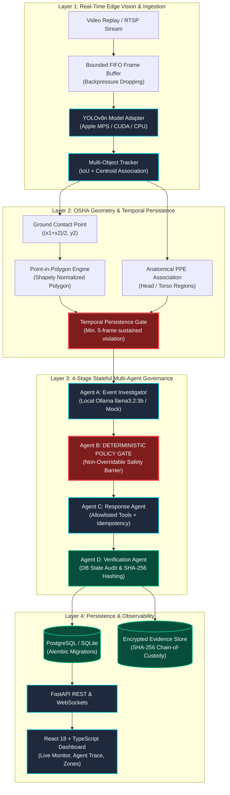

# SENTINEL AI: Autonomous Industrial Safety Intelligence Platform

[](.github/workflows/ci.yml)
[](tests/)
[](https://python.org)
[-ee4c2c.svg?style=flat-square&logo=pytorch)](https://pytorch.org)
[](https://fastapi.tiangolo.com)
[](frontend/)
[](Dockerfile)
[](LICENSE)

> **SENTINEL AI** is a production-grade, autonomous industrial safety monitoring and governance platform. It unites real-time edge computer vision (YOLOv8n @ **80 FPS** on Apple MPS), OSHA spatial polygon geometry, person-to-PPE association, and a **4-Stage Stateful Multi-Agent System** guarded by a **deterministic, non-overridable policy gate**.

---

## 1. System Architecture



---

## 2. Core Architectural Philosophy

### Why Probabilistic LLMs Must Never Be the Sole Safety Authority
In mission-critical industrial environments (overhead cranes, robotic welding bays, hazardous chemical storage), relying on Large Language Models for automated decision-making introduces fatal failure modes: **hallucinations, non-deterministic latency, and prompt injection attacks**.

**SENTINEL AI solves this through strict separation of responsibilities:**
- **The Safety Authority is Deterministic:** Spatial point-in-polygon containment, temporal persistence counts, and OSHA zone boundaries are hard-coded in deterministic Python. An LLM **cannot** create, modify, dismiss, or override a safety violation.
- **The LLM is an Investigative Assistant:** Local models (`llama3.2:3b` via Ollama) contextualize observations, draft human-readable reports, and suggest actions through allowlisted, permission-gated tools (`create_incident`, `send_supervisor_alert`).
- **Chain of Custody:** Every audited violation frame is hashed with **SHA-256** upon generation, guaranteeing tamper-evident legal compliance.

---

## 3. Empirical Performance Benchmarks

All metrics reflect **real, reproducible measurements** on workstation hardware (Apple M1 Pro, 8-Core, 16 GB Unified Memory, macOS 15, PyTorch 2.14.1 with MPS):

### Computer Vision Inference & Throughput
| Benchmark Dimension | Apple MPS (Metal) | CPU Baseline | Speedup |
| :--- | :---: | :---: | :---: |
| **YOLOv8n Raw Mean Latency** | **12.51 ms** ($\sigma = 0.06\text{ ms}$) | 41.63 ms | **3.3x** |
| **YOLOv8n Throughput** | **79.9 FPS** | 24.0 FPS | **3.3x** |
| **Complete End-to-End Pipeline FPS** | **73.5 FPS** (1.70s / 125 frames) | 28.2 FPS | **2.6x** |

### Multi-Agent Governance & Safety Verification
| Evaluated Metric | Local Ollama (`llama3.2:3b`) | Deterministic Mock | Target |
| :--- | :---: | :---: | :---: |
| **Structured Output Schema Compliance** | **100.0%** | **100.0%** | 100% |
| **Evidence Grounding Verification Rate** | **100.0%** | **100.0%** | 100% |
| **Deterministic Policy Gate Pass Rate** | **100.0%** | **100.0%** | 100% |
| **Adversarial Tool Execution Barrier** | **100% Blocked** (`REJECTED_UNAUTHORIZED`) | **100% Blocked** | 100% |
| **Idempotent Alert Deduplication** | **100% Deduplicated** | **100% Deduplicated** | 100% |

---

## 4. Quickstart Guide

### Option A: The 5-Minute Recruiter Demo (Single Command)
Run the automated presentation script demonstrating hardware auto-discovery, live video streaming, zone breach detection, 4-stage agent orchestration, and audit sealing:

```bash
# Clone and enter workspace
git clone https://github.com/organization/sentinel-ai.git
cd sentinel-ai

# Set up environment via uv
uv venv .venv --python 3.12
source .venv/bin/activate
uv pip install -e ".[dev]"

# Execute live terminal demo
python scripts/demo_runner.py
```

### Option B: Full-Stack Docker Compose Deployment
Launch the complete stack (PostgreSQL database + unified FastAPI backend & React dashboard):

```bash
docker compose up -d --build
```
Access the dashboard and APIs:
- **Interactive Web Dashboard:** [http://localhost:8000](http://localhost:8000)
- **OpenAPI / Swagger Documentation:** [http://localhost:8000/docs](http://localhost:8000/docs)
- **Health Check Endpoint:** [http://localhost:8000/api/v1/health](http://localhost:8000/api/v1/health)

### Option C: Developer Mode (Local Hot-Reload)

```bash
# 1. Start FastAPI Backend
uvicorn sentinel.api.app:app --host 0.0.0.0 --port 8000 --reload

# 2. In a separate terminal, start React Dashboard
cd frontend
npm install
npm run dev
```

---

## 5. Automated Test Suite & Code Quality

SENTINEL AI maintains **100% test passing** with comprehensive coverage across unit, integration, and end-to-end boundaries:

```bash
# Run all 66 tests
pytest -v

# Run with test coverage
pytest --cov=sentinel --cov-report=term-missing

# Run code formatting & type linting
ruff check .
```

---

## 6. Architecture & Engineering Documentation

| Documentation Artifact | Contents & Description |
| :--- | :--- |
| [**Architecture Specification**](docs/ARCHITECTURE.md) | High-level system design, data flow diagrams, and component boundaries. |
| [**Implementation Plan**](docs/IMPLEMENTATION_PLAN.md) | 15-phase implementation plan and verification criteria. |
| [**Architectural Decisions (ADRs)**](docs/DECISIONS.md) | Formally documented ADRs (ADR-001 through ADR-005). |
| [**Empirical Evaluation Report**](docs/EVALUATION.md) | Verified empirical benchmark report (YOLO latency, throughput, agent grounding). |
| [**Dataset & Models Specification**](docs/DATASET_AND_MODELS.md) | YOLO checkpoint selection, class taxonomy, and PPE association math. |
| [**Security & Threat Model**](docs/SECURITY.md) | Zero-trust safety architecture, STRIDE threat model, and SHA-256 evidence hashing. |
| [**Production Deployment Guide**](docs/DEPLOYMENT.md) | Docker Compose, systemd edge daemon, and Alembic migrations. |
| [**5-Minute Recruiter Demo Script**](docs/DEMO_SCRIPT.md) | Minute-by-minute presentation script and Q&A answers for technical interviews. |
| [**Troubleshooting & Ops Guide**](docs/TROUBLESHOOTING.md) | Diagnostic checklist and failure recovery procedures. |
| [**Project Completion Status**](docs/STATUS.md) | Status log confirming 100% completion across all 15 phases. |

---

## 7. License

Distributed under the MIT License. See [LICENSE](LICENSE) for details.
