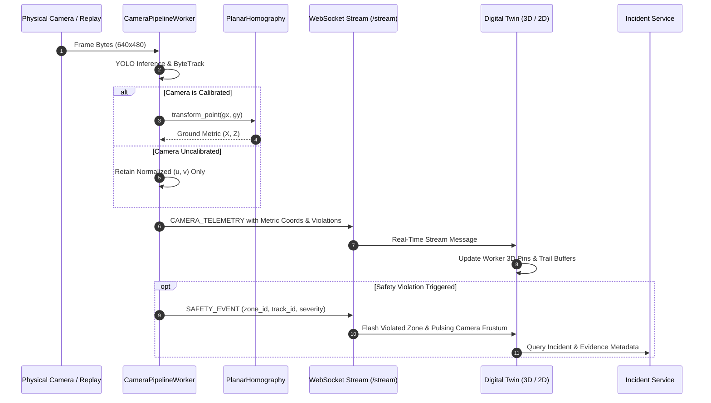

# SENTINEL AI — Operational Digital Twin Architecture Specification

**Author:** Principal Software Architect, Computer Vision Engineer, Real-Time Streaming Engineer, and SRE  
**Date:** October 2026  
**Status:** Approved Architectural Blueprint — Phase 0 Complete  
**Repository:** `~/AI_Agent_CV` (`main` @ `46f2602`)  
**Baseline Test Verification:** **101 tests passed, 0 failures** (`pytest -v`)  
**Static Code Analysis:** **All checks passed** (`ruff check src/ tests/`)  
**Frontend Production Build:** **Compiled in 909ms with 0 errors** (`npm run build`)  

---

## 1. Executive Mission & System Boundary

The **SENTINEL AI Digital Twin** is an interactive, data-connected spatial visualization layer for industrial safety operations. It bridges physical plant operations with the existing computer vision and deterministic safety engine, providing:

1. **3D Factory Scene Visualization:** High-fidelity, lightweight 3D plant representation (floors, walkways, equipment, racks, restricted zones, and camera locations) with an instant 2D floor-plan fallback.
2. **Camera Network & Estimated Coverage:** Spatial camera placement, orientation, field-of-view frustums, live operational health indicators, and direct in-scene live video playback (`/api/v1/cameras/{id}/live`).
3. **Calibrated Spatial Tracking Mapping:** Transformation of 2D bounding-box ground-contact points into metric floor coordinates via `PlanarHomography`, strictly isolated to cameras with valid calibration matrices.
4. **Live Incident & Safety Event Presentation:** Real-time visual alerts on violated zones and observing cameras driven by authoritative backend safety events without client-side decision fabrication.
5. **Historical Replay & Simulation Timeline:** Replay of persisted tracking observations and historical incident timelines with play, pause, seek, and speed controls.
6. **Enterprise Governance & Safety Integrity:** Full RBAC enforcement, credential masking, auditable scene configuration changes, and explicit separation between live, replay, and simulated data.

> [!IMPORTANT]
> The Digital Twin is strictly a presentation and operational analytics layer. It **never overrides or replaces** the deterministic safety engine (`TemporalEventEngine`), policy gate (`PolicyGate`), or evidence verification systems (`EvidenceRepository`).

---

## 2. Discovered Interfaces & Existing Repository Capabilities

| Subsystem / Interface | File Path | Existing Capability & Integration Vector |
|:---|:---|:---|
| **Planar Homography** | `src/sentinel/vision/geometry.py` | `PlanarHomography` provides $3 \times 3$ projective mapping from camera image points $(u, v)$ to metric floor coordinates $(X, Y)$ via `transform_point()` and `inverse_transform_point()`. Includes collinearity and singular matrix detection. |
| **Ground-Contact Geometry** | `src/sentinel/vision/ground_contact.py` | `calculate_ground_contact(bbox)` calculates normalized foot-contact $(x_{mid}, y_2)$ with documented physical limitations regarding parallax, foot occlusion, and non-upright postures. |
| **Zone Management** | `src/sentinel/rules/zones.py` | `ZoneManager` and `RestrictedZone` provide Shapely-based polygon containment testing, normalized coordinate verification, and zone classification (`RESTRICTED`, `WARNING`, `SAFE`). |
| **Camera Management** | `src/sentinel/vision/camera_manager.py` | `CameraManager` and `CameraPipelineWorker` manage multi-camera isolation, YOLO inference concurrency (`asyncio.Semaphore(2)`), and live MJPEG streaming. |
| **WebSocket Telemetry** | `src/sentinel/api/routers/stream.py` | Authenticated `/api/v1/stream` broadcasts `CAMERA_TELEMETRY` frames containing track IDs, bounding boxes, confidences, and ground points. |
| **Incidents & Evidence** | `src/sentinel/db/repositories/incident_repo.py`, `evidence_repo.py` | Multi-dimensional query filtering by `camera_id`, `zone_id`, `status`, and `severity`; SHA-256 evidence integrity validation on retrieval. |
| **Authentication & RBAC** | `src/sentinel/security/auth.py` | Server-trusted JWT tokens with role boundaries (`VIEWER`, `SAFETY_OFFICER`, `ADMIN`). |
| **Frontend Framework** | `frontend/package.json`, `App.tsx` | React 18 + TypeScript + Vite, Lucide icons, responsive navigation layout. |

---

## 3. Coordinate Systems & Spatial Transforms

The Digital Twin harmonizes three distinct coordinate reference frames:

```
+--------------------------------------------------------------------------------------------------+
|                                  COORDINATE FRAME CONVERSIONS                                    |
|                                                                                                  |
|  1. Normalized Image Space (Camera Sensor)                                                       |
|     (u, v) in [0.0, 1.0] x [0.0, 1.0], origin (0, 0) at top-left.                                |
|                                   │                                                              |
|                                   ▼  PlanarHomography.transform_point(u, v)                      |
|                                                                                                  |
|  2. Calibrated Metric Floor Space (2D Ground Plane)                                              |
|     (X_floor, Z_floor) in meters, origin (0, 0) at plant datum (SW corner of factory bay).       |
|                                   │                                                              |
|                                   ▼  World Transform Matrix                                      |
|                                                                                                  |
|  3. 3D World Space (Three.js Scene Graph)                                                        |
|     (X_w, Y_w, Z_w) in meters:                                                                  |
|       - X_w: East / Bay Width (0 to 60m)                                                         |
|       - Y_w: Elevation / Height Upwards (0 to 12m)                                               |
|       - Z_w: North / Bay Depth (0 to 40m)                                                        |
+--------------------------------------------------------------------------------------------------+
```

### 3.1 Spatial Calibration Rules
1. **Uncalibrated Sources:** When a camera lacks a verified `PlanarHomography` matrix, detections **must not** be projected onto the 3D ground plane.Detections remain visible in the single-camera focus HUD, and the Twin displays an explicit `CALIBRATION_PENDING` badge.
2. **Projective Horizon Rejection:** Points that project behind the camera or into optical infinity ($w \le 10^{-9}$ in homogeneous projection) are discarded with out-of-bounds error counters.
3. **Boundary Clamping:** Mapped worker positions are validated against the enclosing factory floor dimensions (`[0, width] x [0, depth]`). Out-of-bounds points are flagged as anomalous.

---

## 4. Versioned Factory Scene Data Model

The scene schema is decoupled from the rendering engine and defined in `src/sentinel/api/schemas.py`:

```typescript
export interface FactorySceneModel {
  schema_version: string;             // e.g. "1.0.0"
  factory_id: string;                 // e.g. "factory-plant-alpha"
  name: string;                       // "Advanced Automotive Assembly Plant"
  site_id: string;                    // "site-north-01"
  dimensions: {
    width_meters: number;             // 60.0
    depth_meters: number;             // 40.0
    height_meters: number;            // 10.0
  };
  floors: FloorLevel[];
  equipment: EquipmentAsset[];
  walkways: WalkwayPath[];
  zones: SpatialSafetyZone[];
  cameras: SpatialCameraNode[];
  updated_at: string;
  updated_by: string;
}

export interface SpatialCameraNode {
  camera_id: string;
  name: string;
  position: [number, number, number]; // [X, Y, Z] in meters
  rotation_euler: [number, number, number]; // [pitch, yaw, roll] in degrees
  height_meters: number;
  fov_horizontal_deg: number;
  calibrated: boolean;
  homography_matrix?: number[][];     // 3x3 array if calibrated
  coverage_polygon_meters: [number, number][]; // Estimated floor projection
  enabled: boolean;
}

export interface SpatialSafetyZone {
  zone_id: string;
  name: string;
  zone_type: 'RESTRICTED' | 'WARNING' | 'SAFE';
  polygon_meters: [number, number][]; // 2D floor coordinates [X, Z]
  height_meters: number;
  color_hex: string;
  active_rules: string[];
}
```

---

## 5. End-to-End Real-Time Event & Replay Flow



---

## 6. Performance & Edge Resource Controls

1. **Geometry Instancing:** Repeated structural elements (structural I-beams, safety bollards, warehouse pallet racks) use `THREE.InstancedMesh` to render hundreds of objects in a single GPU draw call.
2. **Target Frame Rate:** 60 FPS rendering under standard operation; dynamically drops shadow maps if frame rate drops below 30 FPS.
3. **Stale Track Eviction:** Workers that cease receiving detection updates for $>1.5$ seconds are smoothly faded out and pruned from the active scene graph.
4. **Accessible Reduced-Motion Mode:** Respects `prefers-reduced-motion: reduce` by disabling camera transition animations, pulsing alert glows, and continuous turntable rotations.
5. **Memory & Context Cleanup:** On tab navigation, the WebGL context is completely disposed (`renderer.dispose()`, `geometry.dispose()`, `material.dispose()`) to eliminate memory leaks on edge workstations.

---

## 7. Phased Implementation Plan & Acceptance Gates

### Phase 1: Factory Scene & Spatial Data Model
- Define versioned schemas in `src/sentinel/api/schemas.py`.
- Implement `src/sentinel/api/routers/twin.py` with `GET /api/v1/twin/scene` and `PUT /api/v1/twin/scene`.
- Provide default calibrated reference factory scene `data/fixtures/factory_scene_sample.json`.
- **Exit Gate:** Schema validation tests pass; sample layout loads cleanly.

### Phase 2: Interactive 3D Viewer & 2D Fallback
- Create `frontend/src/pages/DigitalTwin.tsx` with Three.js orbit controls, pan, zoom, and layer toggles.
- Add instant 2D architectural floor plan fallback for low-power or headless clients.
- Provide floor selection, camera focus, and layer visibility switches (Zones, Coverage, Tracks, Equipment, Incidents).
- **Exit Gate:** 60 FPS interactive navigation; responsive window resize and resource disposal on unmount.

### Phase 3: Spatial Camera Placement & Coverage Frustums
- Render physical camera bodies at true coordinates with calculated ground-plane coverage cones.
- Clicking any camera opens an embedded picture-in-picture view of its live authenticated stream (`/api/v1/cameras/{id}/live`).
- **Exit Gate:** Camera selection opens authenticated stream without leaking credentials.

### Phase 4: Spatial Mapping of Actual Detections
- Ingest live `CAMERA_TELEMETRY` via WebSocket.
- Map ground contact points to world space using `PlanarHomography` when calibration exists.
- Show live workers as animated 3D markers with track IDs, confidence ratings, and trailing paths.
- Uncalibrated cameras display in HUD with honest `UNMAPPED` indicators.
- **Exit Gate:** Live worker positions update with zero artificial coordinate fabrication.

### Phase 5: Live Safety Events & Incident Integration
- Listen for real-time safety events; highlight violated restricted zones with dynamic red boundary barriers.
- Clicking an alert opens an incident drawer with severity, timestamps, rule IDs, and verified evidence downloads.
- **Exit Gate:** Verified event links directly to authentic SHA-256 evidence.

### Phase 6: Historical Replay & Simulation Timeline
- Add replay scrubber to inspect historical incidents and reconstruct temporal track paths.
- Distinctly label historical replay and synthetic simulation modes to prevent operational confusion.
- **Exit Gate:** Replay scrubber correctly recreates historical incident state.

### Phase 7: Calibration Tooling & Heatmaps
- Interactive 4-point correspondence tool to compute and validate `PlanarHomography` matrices.
- Density heatmap overlay displaying zone traffic and violation risk hotspots.
- **Exit Gate:** Degenerate correspondence configurations are detected and rejected.

### Phase 8: Verification, Regression Testing & Final Report
- Add automated regression tests covering scene validation, homography projection, coordinate bounds checking, and WebSocket telemetry.
- Execute full test suite, ruff lint, and production frontend build.
- Produce `docs/DIGITAL_TWIN_IMPLEMENTATION_REPORT.md`.
