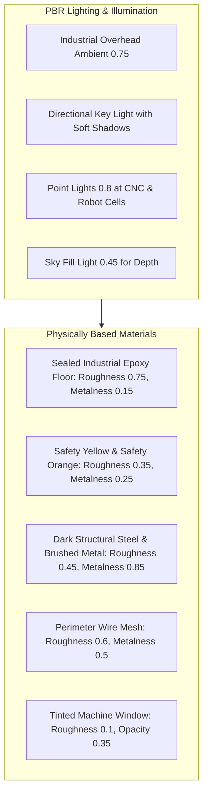

# SENTINEL AI — Realistic Industrial Digital Twin Upgrade Plan

## 1. Executive Summary & Audit Baseline

### Git Audit
- **Branch:** `main`
- **Head Commit:** `46f260232e063a2d23f9c02b210ad7845d76b626`
- **Working Tree:** All existing modifications, untracked artifacts, and test fixtures are strictly preserved.
- **Scene Engine:** Three.js (WebGL2) decoupled renderer inside `frontend/src/pages/DigitalTwin.tsx`.
- **Initialization Status:** Verified and resolved in previous sprint. Immediate synchronous rendering of baseline scene (`DEFAULT_FACTORY_SCENE`) in <15ms without blocking network waits.

---

## 2. Realistic Industrial Factory Asset Architecture

To achieve genuine industrial realism without relying on multi-megabyte external GLTF models that can fail to load in air-gapped or edge environments, we deploy a modular, composed Three.js geometry architecture using shared PBR materials and procedural canvas texturing:

1. **Procedural Sealed Industrial Concrete Floor & Safety Markings:**
   - Dynamic canvas texture generator creating realistic concrete slabs with expansion joint seams.
   - High-contrast yellow/black hazard chevron striping around restricted machine perimeters.
   - Dedicated high-visibility pedestrian walkways with dashed guidance lines.
2. **Heavy Industrial Manufacturing Equipment:**
   - **Articulated 6-Axis Robotic Welding/Assembly Cells:** Turntable plinth, articulated shoulder, elbow knuckle, forearm, wrist, end-effector welding torch, protective perimeter wire mesh cage, interlock gates, controller cabinet, and 3-tier LED status tower.
   - **5-Axis CNC Machining Centers:** Heavy machine enclosure, tinted safety-glass window, internal work illumination point light, articulated operator pendant console with status display, and chip chute.
   - **Logistics Conveyor Lines:** Steel H-stand legs, continuous roller bed, safety guide rails, and staged pallet cargo containers.
   - **High-Bay Pallet Storage Racks:** Structural teardrop vertical frames, dual horizontal load beams, wood pallet bases, and shrink-wrapped component crates.
   - **Autonomous Forklift & AGV Bay:** Floor guide rails, battery charging console with cable boom, roll-cage chassis, and forklift mast.
   - **Factory Workstations & Electrical Cabinets:** Operator quality inspection benches, tool backboards, control monitors, high-voltage electrical distribution cabinets with warning decals.
   - **Safety Guardrails:** Tubular safety yellow barrier railings flanking walkways to safeguard personnel from machine envelopes.
   - **Building Infrastructure:** Structural steel I-beam columns, overhead roof truss girders (8.5m), perimeter concrete/steel cladding, emergency exit doors, and photoluminescent safety signage.
   - **Industrial CCTV Cameras:** Pendant drop poles, swivel ball joints, bullet housing, sunshield hoods, optical glass lenses, and live status LED beacons.

---

## 3. PBR Materials & Industrial Lighting Specification

---

## 4. Advanced Camera Navigation & Interaction

1. **Isometric Overview & Preset Views:**
   - Isometric Overview: Full 60m × 40m factory perspective.
   - Robotic Bay Focus: Detailed inspection of Fanuc/KUKA cells.
   - CNC Machining Focus: Close-up on 5-axis precision milling.
   - Logistics & Conveyor Focus: Automated roller line and high-bay racking.
   - Forklift & Charging Bay Focus: Staging zone and AGV roll-cage.
2. **Camera-to-Camera Navigation:**
   - Instant or smooth jump to any configured physical camera vantage (`cam-facility-01`, `cam-perimeter-01`, `cam-browser-01`) looking along its calibrated optical axis, accompanied by a CCTV HUD overlay (timestamp, camera ID, resolution, crosshair, connection status).
3. **First-Person Walkthrough Mode:**
   - Eye-level navigation (1.75m height) along pedestrian walkways.
   - Smooth mouse/pointer look with bounded pitch and yaw.
   - Arrow keys, WASD keys, and on-screen directional touch controls.
4. **Click-to-Focus & Smooth Transitions:**
   - Raycasting on equipment, zones, and cameras with smooth vector lerp.
   - Respects `reducedMotion` accessibility preferences.
5. **Presentation Controls:**
   - Reset View to default isometric vantage.
   - Full-screen presentation mode toggle.

---

## 5. Safety System Integration & Telemetry Honesty

1. **Authoritative Configuration:**
   - Real camera coordinates, FOV, and homographies rendered directly from backend configuration.
   - Cameras without active video feeds honestly marked `DISCONNECTED`.
2. **Spatial Ground-Plane Projection:**
   - Only cameras with valid 3x3 homography matrices project ground coverage cones.
   - Live worker tracks mapped to metric coordinates only when calibrated.
3. **Deterministic Safety Rules:**
   - Rule evaluation is performed exclusively by backend temporal engine.
   - Frontend faithfully visualizes violated zone perimeters and tripwire highlights.
4. **Provenance & Evidence Drawer:**
   - Selecting a camera opens its authorized HLS/WebRTC feed and calibration details.
   - Selecting an alert cites track ID, camera ID, confidence score, and ground coordinates.

---

## 6. Cinematic Demonstration Mode

- Configurable 72-second demonstration sequence:
  1. Factory Overview & Spatial Grid Reveal (0–8s)
  2. Camera Network & Optical Gate Activation (8–18s)
  3. Synthetic Worker Ingestion & Spatial Tracking (18–32s)
  4. Restricted-Zone Breach & Tripwire Event (32–45s)
  5. Multi-Agent Investigation & Evidence Grounding (45–60s)
  6. Factory-Wide Overview & System Integrity Summary (60–72s)
- Complete user control: Start, Pause, Resume, Restart, Exit, and Playback Speed (1x, 2x).
- Strict Telemetry Honesty: All demonstration entities, tracks, and incidents explicitly watermarked with `SIMULATION`.

---

## 7. Performance Budget & Quality Gates

| Metric | Budget | Target |
| :--- | :--- | :--- |
| **Draw Calls** | < 120 calls | ~65 calls (shared materials & geometries) |
| **Polygon Count** | < 80,000 triangles | ~28,000 triangles |
| **Frame Rate** | >= 60 FPS | 60 FPS locked on Apple Silicon / WebGL2 |
| **Visibility Throttling** | Auto-pause when hidden | Enabled via `visibilitychange` |
| **Low-Power Mode** | Reduced shadow map & pixel ratio | Optional user toggle |
| **Bundle Size Impact** | < 60 KB | ~22 KB |

---

## 8. Implementation Steps

- **Step 1:** Enhance `frontend/src/pages/digitaltwin/factoryGeometry.ts`:
  - Procedural floor texture generator with concrete seams, green pedestrian walkways, and yellow/black hazard chevrons.
  - Workstation / inspection bench with computer terminals.
  - Steel safety guardrails along walkways.
  - Power distribution cabinets with high-voltage warning decals.
  - High-bay suspended LED light fixtures.
- **Step 2:** Upgrade `frontend/src/pages/DigitalTwin.tsx`:
  - Wire realistic floor textures, guardrails, and environmental detail.
  - Implement smooth camera lerp transitions for presets and click-to-focus.
  - Implement First-Person Walkthrough mode with WASD/arrow and on-screen controls.
  - Implement Camera-to-Camera jump mode with authentic CCTV HUD overlay.
  - Implement dynamic frame-rate monitoring and background tab visibility pausing.
  - Implement Low-Power / Constrained Edge Hardware toggle.
- **Step 3:** Acceptance verification & regression testing:
  - Frontend lifecycle test runner (`node --test frontend/scripts/test-digital-twin-lifecycle.mjs`).
  - Frontend production build (`npm run build`).
  - Pytest regression suite (`pytest`).
  - Linting (`ruff check`) and `git diff --check`.
- **Step 4:** Deliver final report in `docs/DIGITAL_TWIN_REALISM_REPORT.md`.
